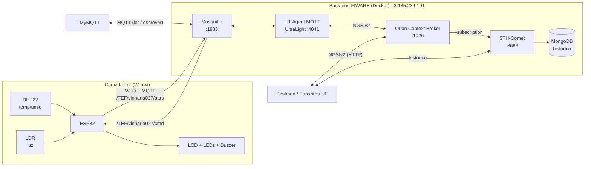

# 🍷 Vinheria Agnello — Monitoramento IoT da Adega com FIWARE

**Checkpoint 05 — Edge Computing & Computer Systems**
FIAP · Engenharia de Software · Prof. Lucas Demetrius Augusto

Fase 2 do projeto da Vinheria Agnello: o ESP32 lê **temperatura e umidade (DHT22)** e **luminosidade (LDR)** da adega, sinaliza localmente (LCD, LEDs e buzzer) e envia cada leitura, **com timestamp**, para o back-end **FIWARE** via **MQTT**. Os dados ficam disponíveis por uma interface **NGSIv2** (Orion Context Broker), seguindo o **Smart Data Model `IndoorEnvironmentObserved`** da União Europeia, e o histórico é gravado pelo **STH-Comet** para gerar gráficos, análises e relatórios.

---

## 👥 Integrantes

| Nome | RM |
|---|---|
| Victor Ulisses de Morais Silva | 572634 |
| Enzo Gabriel Pereira | 570659 |
| Pedro Henrique Moura Aguiar | 570715 |
| Henrique Giusti de Souza | 570766 |
| Pietro Alexandre Guerato Objetivo | 571232 |

---

## 🔗 Links

| Item | Link |
|---|---|
| Simulação no Wokwi | `COLE_AQUI_O_LINK_DO_WOKWI` |
| Vídeo de demonstração | `COLE_AQUI_O_LINK_DO_VIDEO` |

---

## 🎯 Problema e solução

Os proprietários da vinheria pediram, após a fase 1:

| Pedido dos proprietários | Como o projeto atende |
|---|---|
| "Preciso saber exatamente a temperatura e a umidade do depósito" | Valores numéricos enviados a cada ~5 s para o FIWARE e exibidos no LCD e no MyMQTT |
| "Preciso dos dados históricos dos últimos dias e meses" | Assinatura Orion → STH-Comet grava cada leitura no MongoDB (histórico) |
| "Queremos exportar os dados para gráficos e relatórios (rastreabilidade)" | Consultas STH-Comet (brutas e agregadas por hora/dia/mês) |
| "Queremos integrar com distribuidoras do mercado europeu" | Back-end FIWARE, interface NGSIv2 e entidade no padrão Smart Data Models (`IndoorEnvironmentObserved`) |

### Requisitos do enunciado

- [x] Envio dos dados dos sensores ao FIWARE pelo protocolo **MQTT**
- [x] **Timestamp** de cada leitura (atributo `dateObserved`, via NTP, + `TimeInstant` gerado pelo IoT Agent)
- [x] ESP32 conectado à internet por **Wi-Fi**
- [x] Interface de acesso compatível com **NGSI** (NGSIv2 no Orion)
- [x] **Smart Data Models** (`IndoorEnvironmentObserved`, de `dataModel.Environment`)
- [x] **Armazenamento histórico** (STH-Comet + MongoDB)
- [x] Leitura e escrita dos dados pelo app **MyMQTT**

### Faixas ideais usadas (slide 4 do enunciado)

| Grandeza | Ideal | Faixa aceita no código | Alerta |
|---|---|---|---|
| Temperatura | ~13 °C | 10 °C a 16 °C (variação de ±3 °C) | `TEMP_ALTA` / `TEMP_BAIXA` |
| Umidade | ~70 % | 60 % a 80 % | `UMID_ALTA` / `UMID_BAIXA` |
| Luminosidade | penumbra | escuro ≤ 33 %, meia-luz ≤ 66 % | `LUZ_EXCESSIVA` (> 66 %) |

---

## 🏗️ Arquitetura



**Fluxo:** o ESP32 publica as leituras em UltraLight 2.0 no broker → o IoT Agent converte para NGSIv2 e atualiza a entidade no Orion → o Orion notifica o STH-Comet, que grava o histórico no MongoDB. No sentido inverso, um comando (`on`/`off`) enviado pelo Orion ou pelo MyMQTT chega ao ESP32 pelo tópico `/cmd`.

---

## 🔌 Hardware e ligações (Wokwi)

| Componente | Pino do componente | ESP32 DevKit C v4 |
|---|---|---|
| DHT22 | VCC / SDA / GND | 3V3 / **GPIO 15** / GND |
| LDR (módulo fotoresistor) | VCC / AO / GND | 3V3 / **GPIO 34** / GND |
| LCD 16x2 I2C (0x27) | VCC / SDA / SCL / GND | 5V / **GPIO 21** / **GPIO 22** / GND |
| LED verde (+ 220 Ω) | Ânodo | **GPIO 25** |
| LED amarelo (+ 220 Ω) | Ânodo | **GPIO 26** |
| LED vermelho (+ 220 Ω) | Ânodo | **GPIO 27** |
| Buzzer | + / − | **GPIO 14** / GND |

Comportamento local (mantido da fase 1):

- 🟢 **Verde**: ambiente escuro e temperatura/umidade dentro da faixa
- 🟡 **Amarelo**: meia-luz ou temperatura fora da faixa
- 🔴 **Vermelho**: luz excessiva ou umidade fora da faixa
- 🔊 **Buzzer**: toca se houver qualquer problema (pode ser silenciado remotamente pelo comando `off`)
- 📟 **LCD**: alterna entre luminosidade, temperatura, umidade e status da conexão com o FIWARE

---

## 🧩 Modelo de dados (Smart Data Models + NGSIv2)

Entidade: `urn:ngsi-ld:IndoorEnvironmentObserved:vinharia027` · Tipo: **`IndoorEnvironmentObserved`** ([dataModel.Environment](https://github.com/smart-data-models/dataModel.Environment/tree/master/IndoorEnvironmentObserved))

| Chave no MQTT (UltraLight) | Atributo NGSIv2 | Tipo | Unidade (`unitCode`) | Origem |
|---|---|---|---|---|
| `t` | `temperature` | Number | `CEL` (°C) | Smart Data Model |
| `h` | `relativeHumidity` | Number | `P1` (%) | Smart Data Model |
| `i` | `illuminance` | Number | `LUX` (estimado pelo LDR) | Smart Data Model |
| `ts` | `dateObserved` | DateTime | ISO 8601 UTC | Smart Data Model |
| `l` | `luminosity` | Number | `P1` (% de luz, escala da fase 1) | extensão do projeto |
| `a` | `alertStatus` | Text | `OK` ou ex.: `TEMP_ALTA-LUZ_EXCESSIVA` | extensão do projeto |
| `s` | `alarmStatus` | Text | `on` / `off` | extensão do projeto |
| — | `on`, `off` | command | liga / silencia o alarme sonoro | comando |
| — | `name`, `description`, `refDevice` | estáticos | — | Smart Data Model |

> O IoT Agent também adiciona `TimeInstant` (hora de recebimento) a cada atualização.

---

## 📡 Tópicos MQTT

| Uso | Tópico | Exemplo de payload |
|---|---|---|
| ESP32 → FIWARE (leituras) | `/TEF/vinharia027/attrs` | `t\|12.6\|h\|65.5\|i\|151.3\|l\|42\|a\|OK\|s\|on\|ts\|2026-10-23T14:05:31Z` |
| FIWARE / MyMQTT → ESP32 (comando) | `/TEF/vinharia027/cmd` | `vinharia027@off\|` |
| ESP32 → FIWARE (confirmação) | `/TEF/vinharia027/cmdexe` | `vinharia027@off\|alarme silenciado` |

> Formato UltraLight 2.0: pares `chave|valor` separados por `|`. A apikey `TEF` e o service `smart` são os padrões do FIWARE Descomplicado.

---

## 📁 Estrutura do repositório

```
├── README.md
├── wokwi/
│   ├── sketch.ino          # código do ESP32
│   ├── diagram.json        # circuito do Wokwi
│   └── libraries.txt       # bibliotecas do Wokwi
└── postman/
    └── VinheriaAgnello_CP05.postman_collection.json
```

---

## 🚀 Como replicar o projeto

### Pré-requisitos

- Conta no [Wokwi](https://wokwi.com) (gratuita)
- [Postman](https://www.postman.com/downloads/)
- App **MyMQTT** (Android / iOS)
- Servidor FIWARE com **Orion, IoT Agent MQTT, Mosquitto, STH-Comet e MongoDB**. Usamos o servidor fornecido pelo professor (`3.135.234.101`). Para subir o seu, use o [FIWARE Descomplicado](https://github.com/fabiocabrini/fiware) numa VM (Docker + Docker Compose) e libere as portas **1883, 1026, 4041 e 8666** no firewall/security group.

> ⚠️ **Servidor compartilhado:** o `DEVICE_ID` precisa ser único. Usamos `vinharia027`. Se trocar, altere em `sketch.ino` (`#define DEVICE_ID`) **e** na variável `deviceId`/`entityId` da coleção do Postman.

### Passo 1 — Verificar o servidor (Postman)

1. Importe `postman/VinheriaAgnello_CP05.postman_collection.json` (**Import → File**).
2. Confira as variáveis da coleção (aba **Variables**): `url = 3.135.234.101`, `deviceId = vinharia027`.
3. Rode a pasta **1. Verificação do servidor**. As três requisições devem responder `200 OK`.

### Passo 2 — Provisionar o dispositivo (uma única vez)

Na pasta **2. Provisionamento**, execute na ordem:

| Requisição | Resultado esperado |
|---|---|
| 2.1 Criar Service Group | `201 Created` (ou `409` se já existir) |
| 2.2 Provisionar dispositivo | `201 Created` |
| 2.3 Listar dispositivos | `vinharia027` aparece na lista |
| 2.4 Criar assinatura do histórico | `201 Created` |
| 2.5 Listar assinaturas | assinatura com `status: active` |

Todas as requisições usam os headers `fiware-service: smart` e `fiware-servicepath: /`.

### Passo 3 — Rodar a simulação no Wokwi

1. Acesse [wokwi.com/projects/new/esp32](https://wokwi.com/projects/new/esp32) (logado).
2. Substitua o conteúdo de `sketch.ino` e `diagram.json` pelos arquivos da pasta `wokwi/`.
3. Crie o arquivo `libraries.txt` (botão **+** ao lado das abas → *New file*) com o conteúdo de `wokwi/libraries.txt`, ou adicione as bibliotecas pelo **Library Manager**: `PubSubClient`, `DHT sensor library`, `Adafruit Unified Sensor`, `LiquidCrystal I2C`.
4. Clique em **▶ Start**. No Serial Monitor deve aparecer:

```
[WiFi] Conectado! IP: 10.10.0.2
[NTP] Horario UTC: 2026-10-23T14:05:20Z
[MQTT] Conectado!
[MQTT] Inscrito em /TEF/vinharia027/cmd
Luz: 42% (151 lux) | Temp: 12.6C | Umid: 66% | Status: OK
[MQTT] Publicado /TEF/vinharia027/attrs -> t|12.6|h|65.5|i|151.3|l|42|a|OK|s|on|ts|2026-10-23T14:05:31Z
```

5. Clique no **DHT22** e no **LDR** durante a simulação para mudar temperatura, umidade e luz e ver LEDs, LCD, buzzer e os dados enviados mudarem.

### Passo 4 — Leitura e escrita com o MyMQTT

1. Conecte ao broker:
   - **iPhone:** na tela *MQTT Broker* → Host `3.135.234.101`, Port `1883`, SSL desmarcado, **MQTT V3**, sem usuário/senha → **Connect**.
   - **Android:** ☰ → **Settings** → Broker `3.135.234.101`, Port `1883`, sem usuário/senha → salvar e conectar.
2. **Leitura** — em *Subscribe*, assine `/TEF/vinharia027/attrs`. As leituras chegam no *Dashboard* a cada ~5 s, no formato UltraLight (ex.: `t|12.6|h|65.5|i|13.1|l|14|a|OK|s|on|ts|2026-10-23T14:01:25Z`).
   Para ver também as confirmações de comando, assine `/TEF/vinharia027/cmdexe`.
3. **Escrita** — em *Publish*, tópico **`/TEF/vinharia027/cmd`**:
   - `vinharia027@off|` → silencia o buzzer (LCD mostra "Alarme: mudo")
   - `vinharia027@on|` → reativa o alarme sonoro

   O ESP32 confirma em `/cmdexe` e publica `s|off` / `s|on` em `/attrs`, atualizando o `alarmStatus` no Orion.
4. Também é possível **escrever direto um atributo** publicando, por exemplo, `a|TESTE_MYMQTT` em `/TEF/vinharia027/attrs` e conferir a mudança no Orion (requisição 3.1).

### Passo 5 — Consultar os dados via NGSIv2 (Orion)

Pasta **3. Leitura em tempo real**:

```http
GET http://3.135.234.101:1026/v2/entities/urn:ngsi-ld:IndoorEnvironmentObserved:vinharia027?options=keyValues
fiware-service: smart
fiware-servicepath: /
```

Exemplo de resposta:

```json
{
  "id": "urn:ngsi-ld:IndoorEnvironmentObserved:vinharia027",
  "type": "IndoorEnvironmentObserved",
  "temperature": 12.6,
  "relativeHumidity": 65.5,
  "illuminance": 151.3,
  "luminosity": 42,
  "alertStatus": "OK",
  "alarmStatus": "on",
  "dateObserved": "2026-10-23T14:05:31.000Z",
  "name": "Adega Vinheria Agnello",
  "description": "Monitoramento de temperatura, umidade e luminosidade da adega - ESP32, DHT22 e LDR",
  "refDevice": "urn:ngsi-ld:Device:vinharia027",
  "TimeInstant": "2026-10-23T14:05:31.512Z"
}
```

Os comandos também podem ser enviados pelo Orion (pasta **4. Comandos**), que é o caminho usado por aplicações de terceiros:

```http
PATCH http://3.135.234.101:1026/v2/entities/urn:ngsi-ld:IndoorEnvironmentObserved:vinharia027/attrs
{ "off": { "type": "command", "value": "" } }
```

### Passo 6 — Histórico (STH-Comet)

Pasta **5. Histórico**:

- Últimas leituras: `GET :8666/STH/v1/contextEntities/type/IndoorEnvironmentObserved/id/<entityId>/attributes/temperature?lastN=30`
- Agregado por período: `...?aggrMethod=max&aggrPeriod=day&dateFrom=...&dateTo=...` (`aggrMethod`: `max`, `min`, `sum`, `sum2`; `aggrPeriod`: `minute`, `hour`, `day`, `month`)

---

## 🛠️ Solução de problemas

| Sintoma | Causa provável / solução |
|---|---|
| `[MQTT] Falha (rc=-2)` | Broker fora do ar ou porta 1883 bloqueada. Teste a pasta 1 do Postman. |
| Dados chegam no MyMQTT mas não no Orion | Dispositivo não provisionado, ou `DEVICE_ID`/apikey diferentes entre o código e o Postman. Rode 2.3. |
| Histórico vazio no STH | Assinatura não criada (2.4) ou criada depois das leituras — só grava a partir dela. |
| `ts` não aparece no payload | O NTP ainda não sincronizou; aguarde alguns segundos. |
| `Erro sensor DHT` no LCD | Confira o fio de dados do DHT22 no GPIO 15. |
| ESP32 de outro grupo recebendo nossos comandos | `DEVICE_ID` repetido no servidor compartilhado — use um ID único. |

---

## 📚 Referências

- Enunciado do Checkpoint 05 — Prof. Lucas Demetrius Augusto (FIAP)
- [FIWARE Descomplicado — Fábio Henrique Cabrini](https://github.com/fabiocabrini/fiware)
- [Smart Data Models — IndoorEnvironmentObserved](https://github.com/smart-data-models/dataModel.Environment/tree/master/IndoorEnvironmentObserved)
- [Orion Context Broker (NGSIv2)](https://fiware-orion.readthedocs.io/)
- [IoT Agent UltraLight 2.0](https://fiware-iotagent-ul.readthedocs.io/)
- [STH-Comet](https://fiware-sth-comet.readthedocs.io/)
- [Wokwi — ESP32](https://docs.wokwi.com/guides/esp32)
